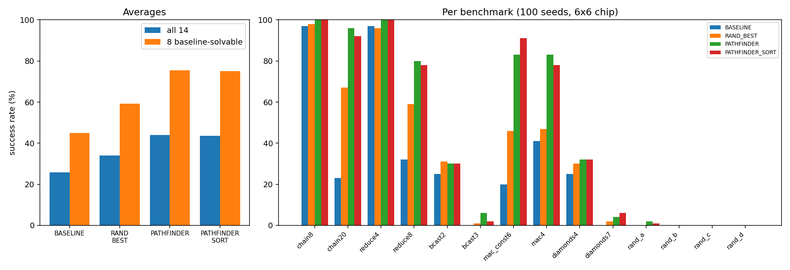

# gramm-repro: learning GRAMM by re-implementing it

*Built with AI assistance; see [../README.md](../README.md).*

A learning exercise on GRAMM (Zhou, Stojilović, and Anderson). I re-implemented its graph-minor mapper from the paper's pseudocode and compared the paper's four variants on a toy CGRA with 14 small dataflow graphs. The aim was to understand why each variant helps, not to match the paper's numbers.

**What I found.** The general improvement from BASELINE through RAND_BEST to PATHFINDER reproduces; the size of the PathFinder gain does not. Average success over 100 seeds for BASELINE, RAND_BEST, PATHFINDER and PATHFINDER_SORT was **26% → 34% → 44% → 44%**, against **29% → 36% → 97% → 98%** in the paper. SORT showed no measurable overall benefit here.

## What I built

A directed 6×6 toroidal device graph (an ALU vertex and an output-multiplexer vertex per processing element, I/O vertices on two edge columns), an independent legality checker, vertex-weighted Dijkstra, the paper's Algorithms 1–2 with a fan-in routing rule, and all four variants. The grid size was chosen with BASELINE only, on calibration seeds never reused in the experiment, and the grid and benchmark set were frozen before the main run. [DESIGN.md](DESIGN.md) has the modelling decisions, calibration and known limitations.

## Results

Successes out of 100 runs per benchmark and variant on a 6×6 chip. `*` marks a benchmark BASELINE did not solve during calibration.

| Benchmark | BASELINE | RAND_BEST | PATHFINDER | PF_SORT |
|---|---:|---:|---:|---:|
| chain8 | 97 | 98 | 100 | 100 |
| chain20 | 23 | 67 | 96 | 92 |
| reduce4 | 97 | 96 | 100 | 100 |
| reduce8 | 32 | 59 | 80 | 78 |
| bcast2 | 25 | 31 | 30 | 30 |
| bcast3 * | 0 | 1 | 6 | 2 |
| mac_const6 | 20 | 46 | 83 | 91 |
| mac4 | 41 | 47 | 83 | 78 |
| diamonds4 | 25 | 30 | 32 | 32 |
| diamonds7 * | 0 | 2 | 4 | 6 |
| rand_a * | 0 | 0 | 2 | 1 |
| rand_b * | 0 | 0 | 0 | 0 |
| rand_c * | 0 | 0 | 0 | 0 |
| rand_d * | 0 | 0 | 0 | 0 |
| **Average, all 14** | **26%** | **34%** | **44%** | **44%** |
| Average, 8 baseline-solvable | 45% | 59% | 76% | 75% |



The experiment has 5,600 runs (14 benchmarks × 4 variants × 100 seeds). Every success was re-checked by the independent checker, and all variants share the same seeds, so comparisons are paired. With 100 runs, the binomial standard error near 80% success is about 4 percentage points, so small per-benchmark differences should be read cautiously; this is not a full uncertainty analysis.

## Against the paper

- **Reproduces:** RAND_BEST improves on BASELINE (+8 points here, +7 in the paper), and PATHFINDER improves further, turning several hard benchmarks into mostly successful ones: `chain20` 23% → 96%, `mac_const6` 20% → 83%, `reduce8` 32% → 80%.
- **Does not reproduce:** the PathFinder jump is much smaller: 34% → 44% over all 14 benchmarks (59% → 76% over the eight baseline-solvable ones), against 36% → 97% in the paper. SORT's gain also does not appear: the overall average stays at 44%, and the eight-benchmark average drops from 76% to 75%.
- **Possible reasons:** the toy device is more restrictive than the paper's ADRES architecture; six benchmarks stay nearly unmappable for every variant, and `bcast2` and `diamonds4` plateau near 30% on the reported seeds.

### Investigating the plateau

`diagnose.py` (seeds 100–129, outside the reported range) found that 18 of the 19 failed `bcast2` runs ended with exactly one overused vertex: a producer's output-multiplexer vertex claimed by two sibling consumers, while the producer's own model held only its ALU or I/O vertex. Seed 106 showed a different pattern. This suggests an **exit-door problem**: two consumers compete for a producer's output vertex, and raising routing costs cannot resolve it if neither has another feasible route.

`diagnose_order.py` (seeds 100–299) found that the initial processing order was associated with success. Calling a producer "bad" if it comes before all its consumers in the initial order, PATHFINDER succeeded on `bcast2` in 41/48 runs with no bad producer against 46/152 with at least one, and on `diamonds4` in 38/44 against 32/156. This is a strong tendency, not a rule (46 of 152 bad-producer runs still succeeded), and the plateau is seed-sensitive: `bcast2` reached 30% on the reported seeds and 44% on seeds 100–299.

The script also prints (2/3)^k, where k is the number of fan-out producers: the chance that a random order has no bad producer (a producer with two consumers comes first of its three nodes with probability 1/3), not a predicted success rate. For `bcast2` (k=3) and `diamonds4` (k=4) it gives about 30% and 20%, against observed 44% (87/200) and 35% (70/200). For `bcast3` and `diamonds7` (k=7) it gives about 6%, close to the observed 6% and 4%, but only 5 and 11 of the 200 seeds had no bad producer there, succeeding in 1/5 and 2/11 runs, so that agreement is partly coincidence.

Together these point to fan-out ownership as a possible weakness of this implementation that may understate PATHFINDER's benefit. It is a hypothesis, not a proven cause. The code was not changed after the main experiment; any fix should be reported as a separately labelled experiment.

## Limitations

- Toy CGRA with no registers, memory ports or scheduling, and synthetic benchmarks, so absolute success rates are not comparable with the paper's ADRES results.
- Each model has one typed root vertex; the paper allows any device vertex as the root.
- The fan-in routing rule is an approximation, not verified by the checker's four rules; it was monitored separately during testing.
- Output paths are not blocked against input paths, so one vertex could carry incoming and outgoing data in the same territory.
- The stopping rule (10 passes without improvement, at most 100 passes) is my choice, not the paper's.
- One grid size in the main experiment; no resource-usage or runtime comparison with the paper's ILP mapper.
- The six near-unmappable benchmarks stay in the primary all-14 average rather than being removed after seeing results.

## Running the project

Python 3 with the standard library runs the mapper and experiments; `matplotlib` is needed for the chart. Python 3.14.7 reproduces the recorded results for the seeds I spot-checked (`chain8`, BASELINE, seeds 0–11); the version used for the full sweep was not recorded.

```bash
for t in test_*.py; do python3 "$t"; done   # tests
python3 calibrate.py                         # baseline-only grid calibration
python3 run_experiment.py                    # main experiment: results.csv, results_chart.png
python3 diagnose.py                          # optional: exit-door diagnostic
python3 diagnose_order.py                    # optional: initial-order diagnostic
```

The experiment uses seeds 0–99, calibration 10000–10039, and the diagnostics seeds outside the reported range; diagnostics do not modify the main results. Results are reproducible for a fixed environment and code version; runtimes vary between machines.