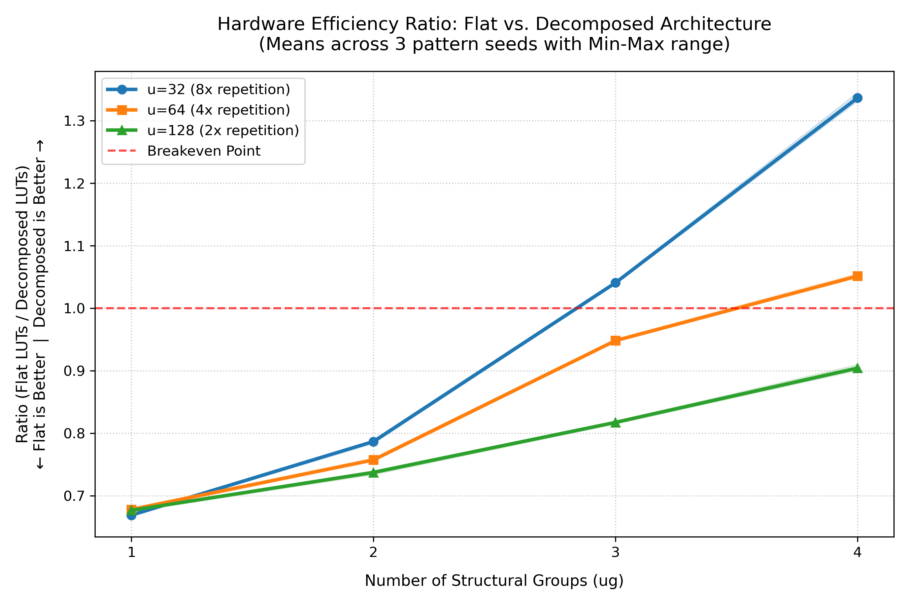

# Flat vs. decomposed pattern matching: a learning exercise

*Built with AI assistance; see the [research-prototypes README](../README.md) for the project-wide disclosure.*

A learning exercise on Garg & Boutros's parser generator ([arXiv:2607.16058](https://arxiv.org/abs/2607.16058)). I wrote a small matcher generator and verified it by simulation, then ran the authors' open-source backend on synthetic patterns and compared flat and decomposed designs with Yosys (the Section VI experiment, at reduced scale). It tests the paper's flat-vs-decomposed claim with a different tool; it does not reproduce the paper's absolute numbers.

## Implementation and attribution

- **`gen_parser.py`:** my generator for the paper's Fig. 2 single-stage matcher, verified by simulation (`tests/`). It emits cascaded ternary operators instead of the paper's `if/else-if` `always_comb` block; both implement first-listed-wins priority (Section III-A).
- **`make_synth.py`, `run_sweep.py`, `plot_results.py`:** my harness for pattern generation, synthesis, data collection and plotting. **`check_cfg.py`, `check_flat.py`:** configuration checks used to investigate discrepancies.
- **RTL backend:** the authors' MIT-licensed backend, commit `23c7c1a29008677637764c2bdf07ebcd505b0e42`, generates the flat and decomposed RTL.

## Setup

| Parameter | Setting |
|---|---|
| Pattern count and width | N = 256, 80 bits |
| Uniqueness (`u`) | 32, 64, 128, giving repetition factors of 8×, 4×, 2× |
| Structural groups (`ug`) | 1, 2, 3, 4 |
| Design configurations | Authors' `synthetic/one_group.json` and `synthetic/multi_group.json` |
| RTL generation flags | `--rtl --tree1 --tree2` |
| Synthesis | `synth -top <top> -nofsm -flatten -lut 6` |
| Synthesis tool | Yosys 0.33 (`yosys-abc` 0.33) |
| Simulation | Icarus Verilog 12.0 |
| Metrics | LUT and flip-flop (FF) counts; no timing measurements |
| Pattern seeds | 1, 2, 3 |
| Paper's setting (reference only) | N = 4096, `u` ∈ {256, 512, 1024}, Vivado 2025.2 on AMD Versal (xcvc1902) |

FSM extraction is disabled to keep the netlist comparison simple.

## Reproducing

The harness expects the authors' repository at `~/patterns-to-parsers`. `check_cfg.py` and `check_flat.py` reuse `sweep_work/u32_ug1_s1.pir`, so run the sweep first:

```bash
python3 run_sweep.py      # writes results_seeded.csv; resumes completed configurations
python3 plot_results.py   # table and chart
```

Pattern generation is not fully reproducible between runs (see Limitations), so a fresh sweep reproduces the counts to within about 0.5% per point. Simulation evidence for `gen_parser.py` (passing tests, a deliberately introduced failure, overlapping-pattern priority) is in [`tests/README.md`](tests/README.md).

## Results

Mean LUT counts across three pattern seeds. The ratio is **Flat LUTs / Decomposed LUTs**; values above 1 favour the decomposed design.

| Repetition | Uniqueness (`u`) | Groups (`ug`) | Flat LUTs (mean) | Decomposed LUTs (mean) | Ratio | Decomposed FFs |
|---|---:|---:|---:|---:|---:|---:|
| **8×** | 32 | 1 | 2497 | 3732 | 0.67 | 129 |
| **8×** | 32 | 2 | 2305 | 2929 | 0.79 | 126 |
| **8×** | 32 | 3 | 2171 | 2086 | 1.04 | 123 |
| **8×** | 32 | 4 | 1954 | 1462 | 1.34 | 120 |
| **4×** | 64 | 1 | 2547 | 3757 | 0.68 | 130 |
| **4×** | 64 | 2 | 2433 | 3212 | 0.76 | 128 |
| **4×** | 64 | 3 | 2361 | 2490 | 0.95 | 126 |
| **4×** | 64 | 4 | 2174 | 2068 | 1.05 | 124 |
| **2×** | 128 | 1 | 2613 | 3861 | 0.68 | 131 |
| **2×** | 128 | 2 | 2573 | 3490 | 0.74 | 130 |
| **2×** | 128 | 3 | 2544 | 3112 | 0.82 | 129 |
| **2×** | 128 | 4 | 2445 | 2704 | 0.90 | 128 |



The flat design uses exactly 105 FFs in every run. LUT counts vary across seeds by at most about 1.6% of the mean (largest for decomposed at `u=64`, `ug=4`; flat stays below 1%).

**Data provenance.** All 72 rows of `results_seeded.csv` come from the committed `run_sweep.py`, in two runs (decomposed first, then flat), with `data_width` and `max_width` absent, so the backend skips `parser_top` generation. Because the halves came from separate runs, flat and decomposed rows for the same seed use slightly different pattern sets (see Limitations). An earlier sweep used `col_per_file=1` for the decomposed design plus extra `data_width`/`max_width` keys; it is kept as `results_seeded_colperfile1.csv`. Rerunning the 36 flat points changed individual counts by at most 13 LUTs (0.5%) and the table's means by at most 5, with no ratio changing at two decimals; the earlier flat rows are in `results_seeded_before_flat_rerun.csv`. As a check, `check_flat.py` ran the authors' exact `one_group.json` at `u=32`, `ug=1`, seed 1 and gave 2496 LUTs and 105 FFs, against 2496 in the earlier sweep and 2503 in the rerun; the 7-LUT difference is within run-to-run variation, so the extra config keys do not explain it.

## Observations

- **Crossover.** The decomposed design uses fewer LUTs only with enough repetition and structural grouping: the ratio crosses 1 between `ug=2` and `ug=3` at 8×, between `ug=3` and `ug=4` at 4×, and not at all at 2×. The best case is 1.34 at `u=32`, `ug=4`. At the crossovers the ratio exceeds 1 for all three seeds, but only by about 4–5%, with three seeds and one tool.
- **Possible fixed overhead.** At `ug=1` the decomposed design uses about 1.47–1.49× the flat design's LUTs, almost independent of `u`. A structural overhead (such as the extra stage or group structure) is one possible explanation; it is a hypothesis, not a demonstrated mechanism.
- **Flat-design sensitivity.** At `u=32`, flat LUTs fall about 22% from `ug=1` to `ug=4` (2497 → 1954). The paper reports flat LUTs as largely insensitive to repetition with Vivado (a slight drop from `ug=1` to `ug=2`, then a plateau). Yosys/ABC sharing combinational logic may explain the difference; the cause has not been isolated.
- **Flip-flops.** Flat FFs are constant at 105, matching the paper's finding that they do not depend on repetition. Decomposed designs use 120–131, about 14–25% more than flat, which is the opposite ordering to the paper (flat about 9.3–10.4K; decomposed falling from about 5.1K at `ug=1` to 715 at `u=256`, `ug=4`; Vivado 2025.2, N=4096, FFs marked `DONT_TOUCH`). The trend direction matches, since decomposed FFs fall as `ug` and repetition rise, but my drop is small (131 → 120, about 8%). My absolute counts are much smaller: about 90–100× for flat and about 40× for decomposed at `ug=1`, but only about 6× at `ug=4` (120 vs. 715, at different `u`). I did not investigate why.
- **Configuration sensitivity.** The earlier `col_per_file=1` sweep gave 3.5–13.5% fewer decomposed LUTs and roughly half the FFs (62–73), with a best ratio of 1.53 instead of 1.34. For `u=32`, `ug=1`, seed 1, this setting alone moved the result from 3609 to 3743 LUTs and from 71 to 129 FFs, while adding `data_width` and `max_width` changed nothing. So `col_per_file` changes the generated design, not just its file layout.
- **`ug=1` discrepancy.** The paper reports about 2.3× fewer LUTs for decomposed even at `ug=1`; here the ratio is 0.67–0.68, favouring flat. Possible causes (Yosys/ABC vs. Vivado, the smaller pattern count, pattern generation) have not been separated. For context, my flat designs use about 7.6–10.2 LUTs per pattern against about 70 in the paper's flat design at N=4096 (about 285K LUTs at `u=256`, `ug=2–4`); this comparison alone supports no conclusion about the cause.

## Limitations

- Yosys only, with no timing or place-and-route. The paper reports higher Fmax for decomposed designs with Vivado: 230–282 MHz against 166–192 MHz for flat.
- N=256, `u` of 32–128 and repetition of 2×–8× differ from the paper's N=4096, `u` of 256–1024 and 4×–16×, so the sweeps are not directly comparable.
- Patterns are synthetic with repeated substrings and do not represent real-world workloads.
- A control synthesis of the authors' N=4096 flat design (`artifact_out/fig9/flat_u256_ug1`) with the same Yosys flow was killed by the out-of-memory killer at about 2.5 GB on a 3.8 GB WSL machine. The decomposed control was not attempted.
- `make_synth.py` builds each column from a Python `set` before shuffling, so pattern files differ between runs even with the same seed; I confirmed this with different `PYTHONHASHSEED` values for `make_patterns(256, 32, 1, seed=1)`. This is the likely cause of the flat-count differences between runs (up to 13 LUTs, 0.5%), though not isolated further. Sorting the sets would fix it but would mean rerunning all 72 points; the effect is far smaller than the 4–5% crossover margins.

## Appendix: configuration

The authors' Makefile (lines 461–463) uses the same RTL-generation command for both designs:

```bash
PYTHONPATH=engine python3 engine/tools/build_rtl_countluts.py \
    -c <config.json> -m <patterns> -o <output> \
    --rtl --tree1 --tree2
```

| Setting | Flat (`one_group.json`) | Decomposed (`multi_group.json`) |
|---|---:|---:|
| `num_cols` | 1 | 4 |
| `char_per_col` | 20 | 5 |
| `col_per_file` | 1 | 4 |
| `custom` | `[]` | `[]` |

These are the authors' original configurations. `run_sweep.py` uses the same settings and flags (serialized with `"custom": []`):

```python
FLAGS = ["--rtl", "--tree1", "--tree2"]

CFG = {
    "flat":       dict(num_cols=1, char_per_col=20, col_per_file=1),
    "decomposed": dict(num_cols=4, char_per_col=5,  col_per_file=4)
}
```